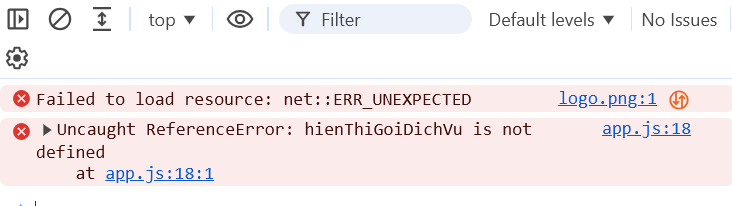

# BÀI LÀM – HACKATHON 02

- **Mã đề:** 07
- **Họ tên:** : Nguyen Thanh Phat
- **Lớp:** K26-CNTT2
- **Link repository:**https://github.com/thanhphat365/IT108_Nhap_Mon_CNTT_Hackathon02
- **Hệ điều hành (Windows/macOS):** Windowns

## 4.2. Thao tác máy tính cơ bản bằng CLI

### Các lệnh đã chạy

```shell
PS C:\starter-kit\Spa Website FINAL> mkdir data


    Directory: C:\starter-kit\Spa Website FINAL


Mode                 LastWriteTime         Length Name
----                 -------------         ------ ----
d-----        11/11/2026   1:41 PM                data


PS C:\starter-kit\Spa Website FINAL> mkdir docs && logs
At line:1 char:12
+ mkdir docs && logs
+            ~~
The token '&&' is not a valid statement separator in this version.
    + CategoryInfo          : ParserError: (:) [], ParentContainsErrorRecordException
    + FullyQualifiedErrorId : InvalidEndOfLine

PS C:\starter-kit\Spa Website FINAL> mkdir docs


    Directory: C:\starter-kit\Spa Website FINAL


Mode                 LastWriteTime         Length Name
----                 -------------         ------ ----
d-----        11/11/2026   1:42 PM                docs


PS C:\starter-kit\Spa Website FINAL> mkdir evidence


    Directory: C:\starter-kit\Spa Website FINAL


Mode                 LastWriteTime         Length Name
----                 -------------         ------ ----
d-----        11/11/2026   1:42 PM                evidence


PS C:\starter-kit\Spa Website FINAL> mkdir logs


    Directory: C:\starter-kit\Spa Website FINAL


Mode                 LastWriteTime         Length Name
----                 -------------         ------ ----
d-----        11/11/2026   1:42 PM                logs


PS C:\starter-kit\Spa Website FINAL> ls -force


    Directory: C:\starter-kit\Spa Website FINAL


Mode                 LastWriteTime         Length Name
----                 -------------         ------ ----
d-----        11/11/2026   1:42 PM                data
d-----        11/11/2026   1:42 PM                docs
d-----        11/11/2026   1:42 PM                evidence
d-----        11/11/2026   1:43 PM                logs
d-----         11/3/2026   7:07 AM                web
-a----         11/3/2026   7:07 AM             75 .env
-a----         11/3/2026   7:07 AM            149 lich-lam-viec.txt
-a----         11/3/2026   7:07 AM             22 temp_707.tmp
PS C:\starter-kit\Spa Website FINAL> mv .\lich-lam-viec.txt .\docs\
PS C:\starter-kit\Spa Website FINAL> mkdir backup


    Directory: C:\starter-kit\Spa Website FINAL


Mode                 LastWriteTime         Length Name
----                 -------------         ------ ----
d-----        11/11/2026   1:45 PM                backup


PS C:\starter-kit\Spa Website FINAL> cp .\data\hoa-don-sp-thang7.xlsx .\backup\
PS C:\starter-kit\Spa Website FINAL> rm *.tmp
PS C:\starter-kit\Spa Website FINAL\docs> ls


    Directory: C:\starter-kit\Spa Website FINAL\docs


Mode                 LastWriteTime         Length Name
----                 -------------         ------ ----
-a----         11/3/2026   7:07 AM            149 lich-lam-viec.txt


PS C:\starter-kit\Spa Website FINAL\docs>
```cd ..
PS C:\starter-kit\Spa Website FINAL> Get-childItem -Recurse -Force

### Kết quả liệt kê toàn bộ dự án (Windows: Get-ChildItem -Recurse -Force; macOS: ls -aR)

```text
(Dán kết quả vào đây – xoá dòng này)


    Directory: C:\starter-kit\Spa Website FINAL


Mode                 LastWriteTime         Length Name
----                 -------------         ------ ----
d-----        11/11/2026   1:45 PM                backup
d-----        11/11/2026   1:42 PM                data
d-----        11/11/2026   1:44 PM                docs
d-----        11/11/2026   1:42 PM                evidence
d-----        11/11/2026   1:43 PM                logs
d-----         11/3/2026   7:07 AM                web
-a----         11/3/2026   7:07 AM             75 .env


    Directory: C:\starter-kit\Spa Website FINAL\backup


Mode                 LastWriteTime         Length Name
----                 -------------         ------ ----
-a----        11/11/2026   1:42 PM          11209 hoa-don-sp-thang7.xlsx


    Directory: C:\starter-kit\Spa Website FINAL\data


Mode                 LastWriteTime         Length Name
----                 -------------         ------ ----
-a----        11/11/2026   1:42 PM          11209 hoa-don-sp-thang7.xlsx


    Directory: C:\starter-kit\Spa Website FINAL\docs


Mode                 LastWriteTime         Length Name
----                 -------------         ------ ----
-a----         11/3/2026   7:07 AM            149 lich-lam-viec.txt


    Directory: C:\starter-kit\Spa Website FINAL\logs


Mode                 LastWriteTime         Length Name
----                 -------------         ------ ----
-a----         11/3/2026   7:07 AM            939 service.log


    Directory: C:\starter-kit\Spa Website FINAL\web


Mode                 LastWriteTime         Length Name
----                 -------------         ------ ----
d-----         11/3/2026   7:07 AM                images
-a----         11/3/2026   7:07 AM            597 app.js
-a----         11/3/2026   7:07 AM            523 index.html
-a----         11/3/2026   7:07 AM            460 style.css


    Directory: C:\starter-kit\Spa Website FINAL\web\images


Mode                 LastWriteTime         Length Name
----                 -------------         ------ ----
-a----         11/3/2026   7:07 AM           3091 logo-lotuscare.png

```

## 4.3. Lọc log truy cập website

### a) Lệnh lọc các dòng status=500

```shell
# Ghi lệnh
get-content .\logs\service.log|Select-String "status=500"
```

### 2 dòng đầu tiên trong logs/loi_500.txt

```text
(Dán kết quả vào đây – xoá dòng này)
2026-07-28 08:12:50 POST /api/dat-lich status=500
2026-07-28 08:19:23 POST /api/dat-lich status=500
2026-07-28 08:31:56 POST /api/lich-trong status=500
2026-07-28 08:55:13 POST /api/dat-lich status=500
2026-07-28 08:59:24 POST /api/lich-trong status=500
2026-07-28 09:02:35 POST /api/thanh-toan status=500```


```

```text
### b) Lệnh đếm số dòng status=404 và kết quả

```shell
# Ghi lệnh vào đây (xoá dòng này)
(get-content .\logs\service.log|Select-String "status=404").count
```

## 4.4. Chạy script tong_hop (.ps1 hoặc .sh)

### Lệnh chạy (Windows: nếu dùng Phụ lục 2 thì ghi cả 2 lệnh)

```shell
PS C:\starter-kit\Spa Website FINAL> @'
>> #Script : tong_hop.ps1
>> #Tac gia : Nguyen Thanh Phat
>> # Ngay tao : 11/11/2026
>> Write-Host "Dang tao bao cao..." >logs/tong_hop.txt
>> "===Bao Cao Su Co Web===" > logs/tong_hop.txt
>> Get-content .\logs\service.log  |select-string "status=404">>logs/tonghop.txt
>> Get-Content .\logs\service.log | Select-string "status=500" | Measure-Object >> logs/tong_hop.txt
>> Write-Host "Hoan thanh!"
>> '@ |Set-Content tong_hop.ps1


```

### Nội dung file logs/tong_hop.txt

```text
#Script : tong_hop.ps1
#Tac gia : Nguyen Thanh Phat
# Ngay tao : 11/11/2026
Write-Host "Dang tao bao cao..." >logs/tong_hop.txt
"===Bao Cao Su Co Web===" > logs/tong_hop.txt
Get-content log\service.log |select-string "status=404">>logs/tonghop.txt
Get-Content logs\service.log | Select-string "status=500" | Measure-Object >> logs/tong_hop.txt
Write-Host "Hoan thanh!"


```

## 4.5. README.md và bảo vệ thông tin bí mật

> README.md, .gitignore và .env.example được chấm trực tiếp trên file ở gốc dự án. Đánh dấu `[x]` vào các mục đã làm để tự kiểm tra.

- [x] README.md: Heading 1, mô tả có **in đậm** và *in nghiêng*, bảng, code block, task list, blockquote
- [x] .gitignore có dòng `.env` (tên file đúng, không có đuôi .txt)
- [x] .env.example có đủ tên biến, giá trị để trống (tên file đúng, không có đuôi .txt)

## 4.6. Kiểm tra trang web bằng DevTools (F12) và báo cáo lỗi

### Bảng lỗi

| STT | Tab DevTools phát hiện lỗi | Tên file hoặc thông báo lỗi | Cách khắc phục |
| --- | --- | --- | --- |
| 1 | failed to load  resource| index.html | doi ten trong dong |
| 2 |hienThiGoiDichVU IS NOT DEFINED  |app.js  |doi ten : hienThiGoiSpa |

> Ảnh chụp màn hình lưu trong thư mục `evidence/` (network.png, console.png).


### Báo cáo lỗi gửi trưởng nhóm

- **Context:** Thua nhom truong phat hien bao loi
- **Expected:** 
- **Actual:** 
- **Log:** 

### Câu tìm kiếm Google

```text


```

## 4.7. Excel

> Phần Excel được chấm trực tiếp trên file `data/hoa_don_spa_thang_7.xlsx`, không cần ghi vào đây.
